# Fitxatge bizneo

Script para automatizar el fichaje

> [!CAUTION]
> Es importante saber, que las cookies del Bizneo caducan cada pocos días, por lo que una vez por semana se tienen que obtener las cookies y pegarlas en el script.

## 1. Crear un Script para el fichaje

### 1.1 Acceso a Apps Script
El primer paso es acceder a  <a href="https://script.google.com" target="_blank" rel="noopener noreferrer">Apps Script de Google</a>

### 1.2 Crear nuevo proyecto
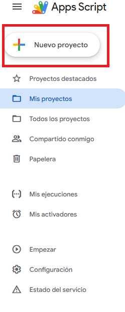

### 1.3 Pegar el código en el nuevo proyecto

Tanto el el fichero de Código.gs como el de secrets.gs, para el de secrets.gs hay que apretar el botón de "+" que aparece en Archivos

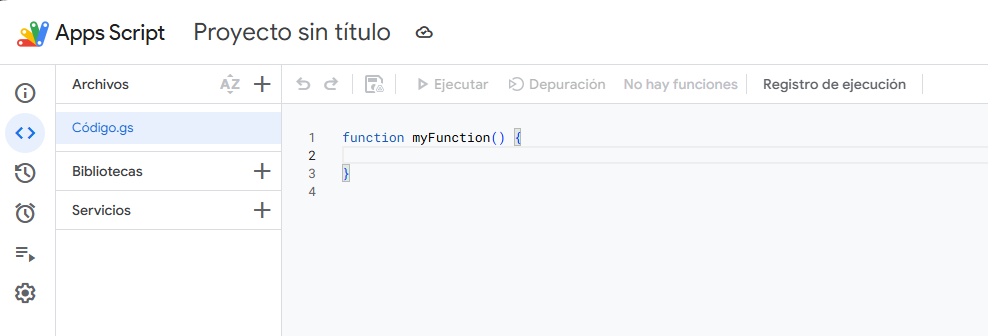

> [!NOTE]
> Una vez pegado los dos códigos, apretar el botón de guardar para que no se pierda la información. El siguiente paso será obtener las cookies de la sesión de Bizneo

## 2. Obtener credenciales de Bizneo

### 2.1 Obtener cookies

Una vez logeado en la pagina de bizneo, hay que apretar boton derecho con el raton y buscar "inspeccionar elemento"
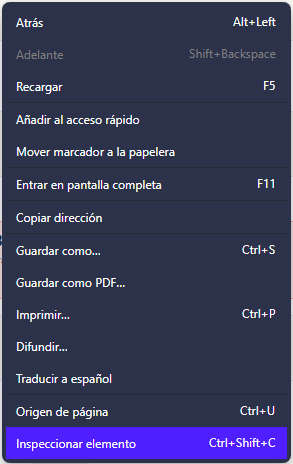

> [!IMPORTANT]
> Si no se ve la pestaña network, ampliar la ventana horizontalmente y seleccionar network.

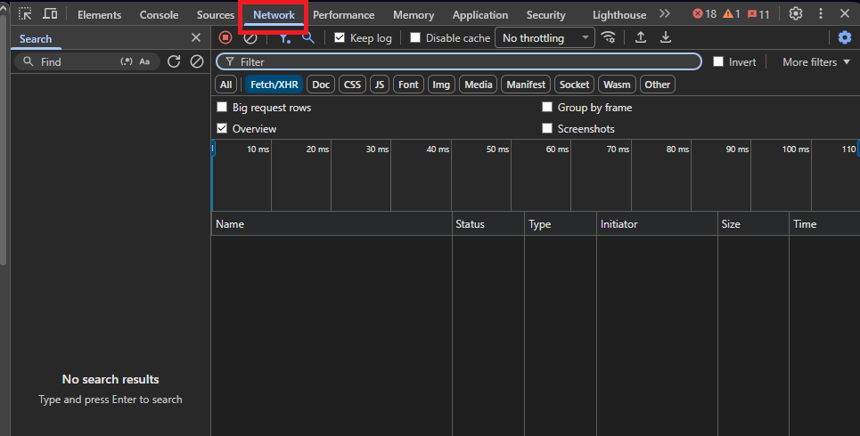

Una vez en la pestaña Network, apretar "iniciar sesión"

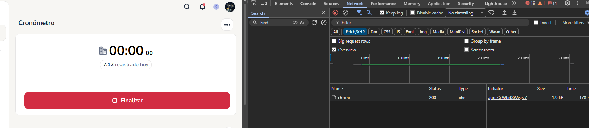

Seleccionar el chrono

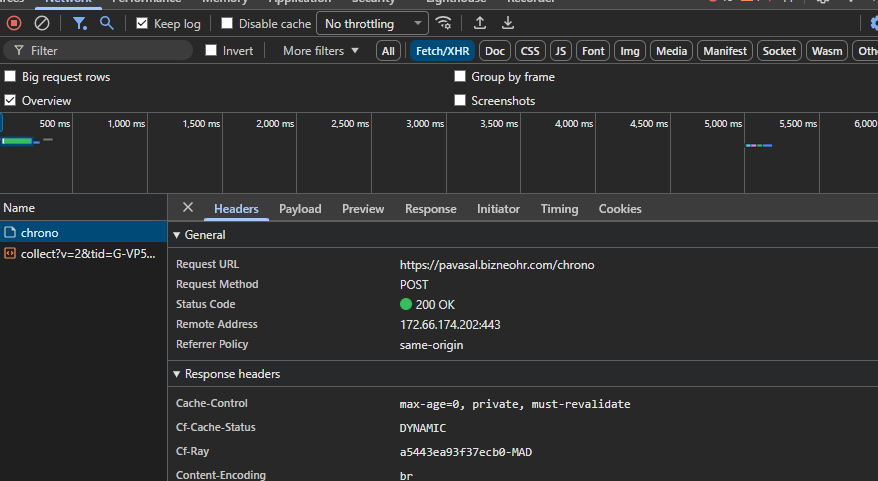

Copiar todo el header de la derecha

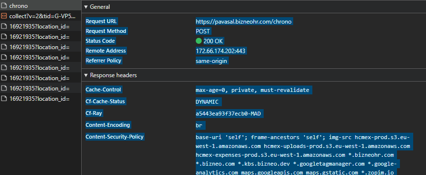

Pegamos todo en un bloc de notas y buscamos las siguientes variables:

  *  _hcmex_key
  *  device_id
  *  x-csrf-token

Con el resultado lo pegaremos en las variables del fichero secrets.gs de Google Apps Scripts

## 2.2 obtener User y shift ID

En la pestaña payload, se pueden obtener el user y shift ID que necesitaremos pegar en secrets.gs

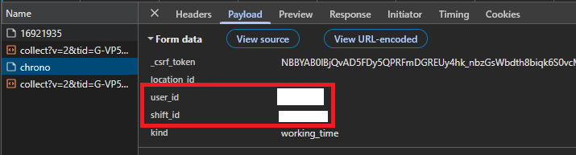

## 2.3 Rellenar el fichero secrets.gs

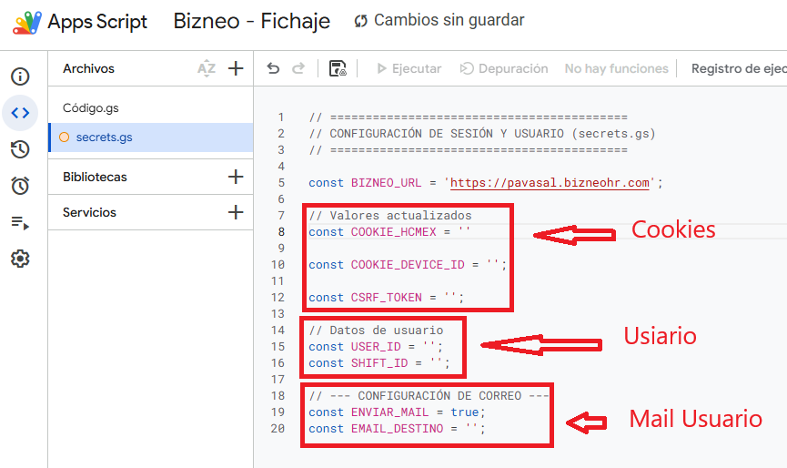

## 3. Ejecutar el script

> [!CAUTION]
> Cuando ya se tengan todas las variables del script de srecets.gs, proceder a este punto

### 3.1 Ejecutar de forma Manual y dar permisos

El primer paso es seleccionar "programarFichajesDelDia" y después darle a "Ejecutar". En breves saldrá una ventana solicitando que des autorización a Apps Script

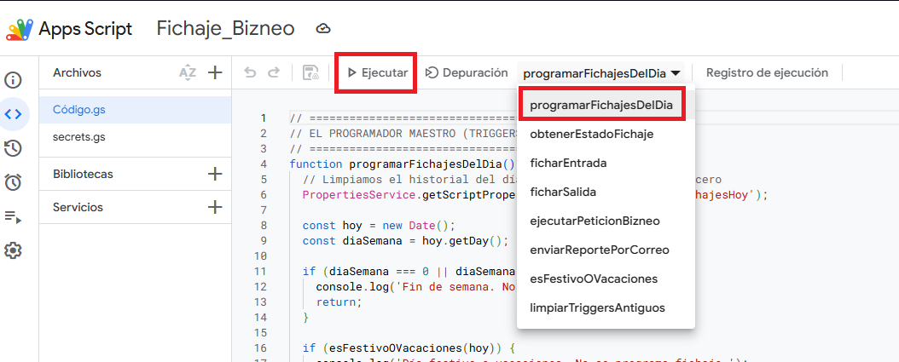

#### 3.2 Crear un activador

El último paso, si funciona lo anterior, es crear un activador

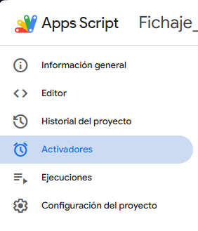

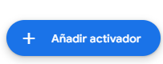

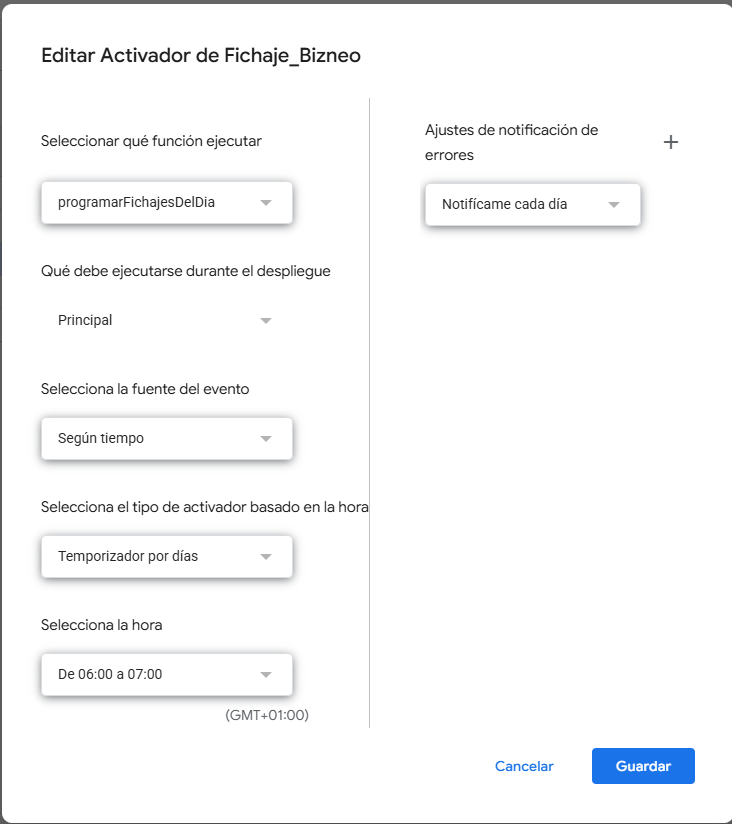
