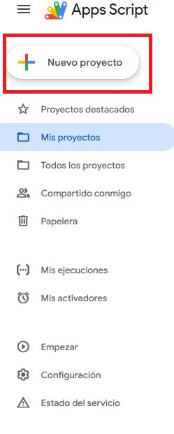
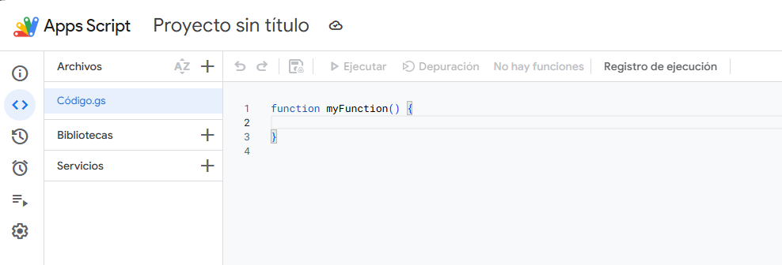

# fitxatge

## 1. Crear un Script para el fichaje

### 1.1 Acceso a Apps Script
El primer paso es acceder a  <a href="https://script.google.com" target="_blank" rel="noopener noreferrer">Apps Script de Google</a>

### 1.2 Crear nuevo proyecto

### 1.3 Pegar el código en el nuevo proyecto

Tanto el el fichero de Código.gs como el de secrets.gs, para el de secrets.gs hay que apretar el botón de "+" que aparece en Archivos

