# fitxatge

## 1. Obtener credenciales de Bizneo

### 1.1 Obtener cookies

Una vez logeado en la pagina de bizneo, hay que apretar boton derecho con el raton y buscar "inspeccionar elemento"
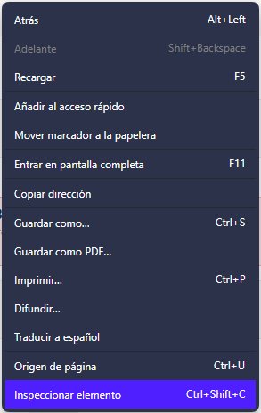

Si no se ve la pestaña network, ampliar la ventana horizontalmente y seleccionar network

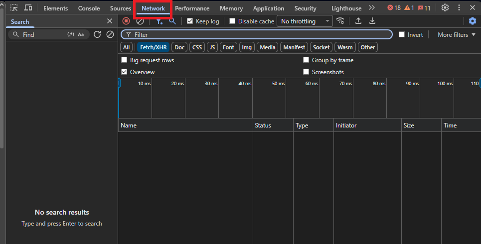

Una vez en la pestaña Network, apretar "iniciar sesión"

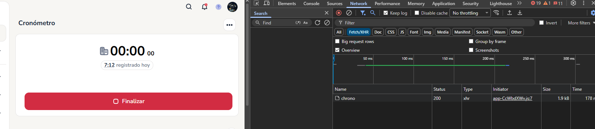

Seleccionar el chrono

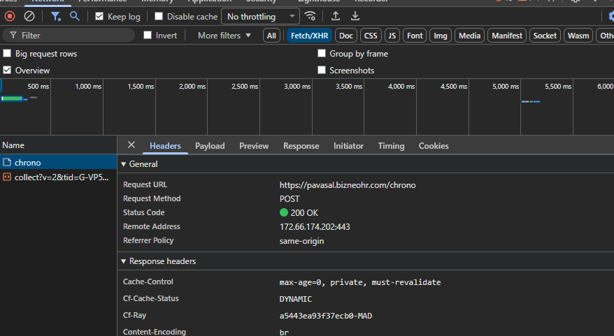

Copiar todo el header de la derecha

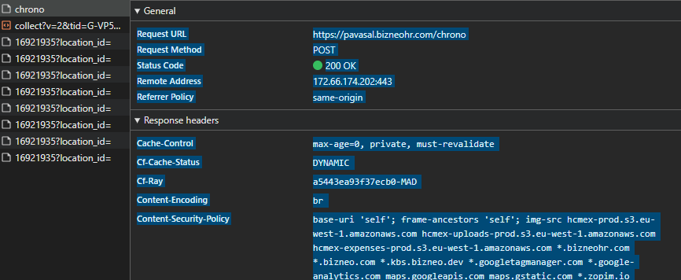

## 2. Acceder al bot PavenerIA

Buscar la aplicación de Google chat "PavenerIA"

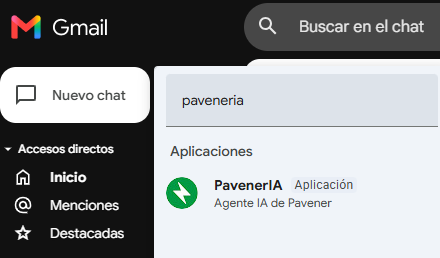

Una vez dentro de la conversación del chat, apretar el botón "+" de al lado de campo de texto y buscar "otros agentes"

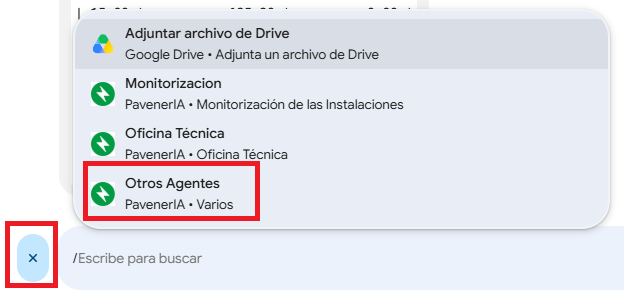

## 3. obtener User y shift ID

## 4. Crear un Script para el fichaje

### 4.1 Acceso a Apps Script
El primer paso es acceder a  <a href="https://script.google.com" target="_blank" rel="noopener noreferrer">Apps Script de Google</a>

### 4.2 Crear nuevo proyecto

### 4.3 Pegar el código en el nuevo proyecto

Tanto el el fichero de Código.gs como el de secrets.gs, para el de secrets.gs hay que apretar el botón de "+" que aparece en Archivos

### 4.4 Ejecutar de forma Manual y dar permisos

El primer paso es seleccionar "programarFichajesDelDia" y después darle a "Ejecutar". En breves saldrá una ventana solicitando que des autorización a Apps Script

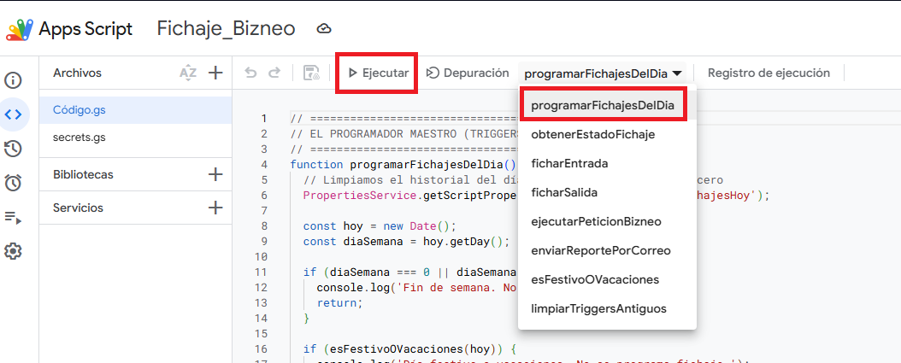

#### 4.5 Crear un activador

El último paso, si funciona lo anterior, es crear un activador

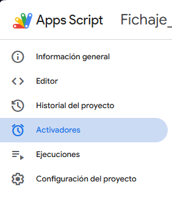

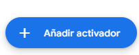

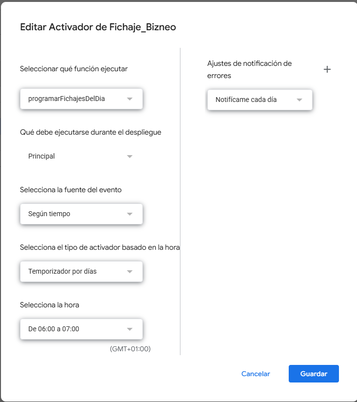
